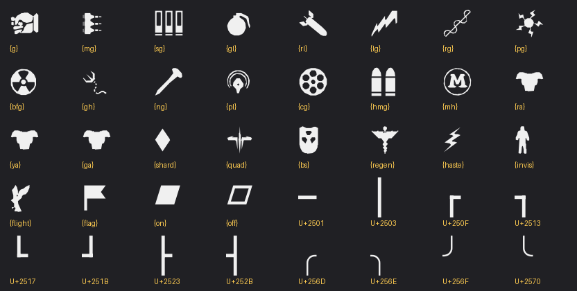

# Mod HUD panel

Three text lines on the player's screen that any plugin fills from the server (`modhud_util.py`), with icons as glyphs of our own font. Gun Game shows the next weapon and the frags towards it on line 1; `modhud.py` writes lines by hand (`!hud`). Design: `docs/superpowers/specs/2026-10-27-mod-hud-panel-design.md`.

## Client package

`zz_modhud.pk3` holds `ui/intro.menu` (stock + nine panels + auto-clear) and `fonts/droidsansfallbackfull.ttf` (stock + our glyphs). The stock files are id's and are not in this repo; build the pk3 from a local pak00:

    python hud/build_modhud.py <QL>/baseq3/pak00.pk3 <out dir>

(needs fontTools, Pillow, numpy, opencv-python). It also writes `glyphs.png`; the copy in this folder is the token table.

The builder also writes `modhud-client.zip`, the package for players: `baseq3/ui/intro.menu`, `baseq3/fonts/droidsansfallbackfull.ttf` and `FRONTIER-HUD-README.txt` (install, positions, binds, chat commands, icon tokens; English and Russian, from `hud/client-readme.txt` with the token list filled in). Players unpack it into `<QL>/<steamid>/`.

**How players install it (verified 2026-10-27):** the two files of the pk3 as loose files in the player's profile, `<QL>/<steamid>/baseq3/ui/intro.menu` and `<QL>/<steamid>/baseq3/fonts/droidsansfallbackfull.ttf`, then restart the game. Loose files there win over pak00 and work on `sv_pure 1` servers, ours and anyone else's. Neither of the two ways below works for players:

- Workshop: a Workshop pk3 cannot replace pak00's files, so the panel and the glyphs do not appear (tested on #27).
- The pk3 itself in `<QL>/baseq3/`: it works, but every pure server without the same pk3 refuses the player ("Unpure client detected").

Was published as the Workshop item [3828349249](https://steamcommunity.com/sharedfiles/filedetails/?id=3828349249) (item folder `D:/MyWorkshopItems/FrontierModHud/` on the operator's machine, uploaded with `steamcmd +workshop_build_item`, same way as the banners item 3822712209). A server ships it with the id in `workshop.txt` (the server downloads it) and in `qlx_workshopReferences` (the `workshop` plugin makes clients download it), comma-separated next to the banners.

The pk3 must be on the server as well: with `sv_pure 1` a client that reads files from a pk3 the server does not have is refused ("Unpure client detected"). The real delivery is a Workshop item in the servers' `workshop.txt` (separate, later step). For a test by hand: the same file in the server's `baseq3/` (restart) and in the player's `<QL>/baseq3/` (the install dir; a pk3 in `<QL>/<steamid>/baseq3/` is not loaded), no loose `<QL>/<steamid>/baseq3/ui/intro.menu` (it would win over the pk3), restart the game.

## Position

Each player in their own console: `seta mod_hud_pos top` (default when unset), `center`, `bottom`, `left`, `topleft`, `bottomleft`, `right`, `topright`, `bottomright` or `off`. The block sits at the left edge, in the middle or at the right edge; inside it the text always starts at the block's left edge (QL does not draw a cvar text item aligned to the centre or right). Right places start the text 120 units (of 640) before the edge, room for about 25 characters; middle places start it 50 units left of the centre, so short lines look centred. Longer lines run past. Free x/y is not possible: a menu rect is fixed in the file. An unset or unknown value means top.

The panel hides itself on the next connect or map load on any server (`onOpen` of the Join Match menu), so a panel left by our server never sticks on someone else's.

## Players without the files

Our `ui/intro.menu` tells the server it is there: Join Match's `onOpen` runs `cmd modhud 1`, the plugins catch it (`client_command` hook, `modhud_util.client_command`). A player in the game who never said hello gets the same lines as a centre print (`cp`, about 3 s, once per change), icons written as labels (`{rl}` -> `RL`); a player with the files gets only the panel. On someone else's server the hello reaches a server that does not know it, which at most prints "unknown command" in the player's console.

## Text and icons

Colours with `^1`..`^7`; icons as tokens, `{{` for a literal `{`:



Weapon tokens equal Gun Game's ladder keys. `{ra}`, `{ya}` and `{ga}` share one shape; colour them (`^1{ra}`, `^3{ya}`, `^2{ga}`). Frame pieces are typed as characters: `━ ┃ ┏ ┓ ┗ ┛ ┣ ┫ ╭ ╮ ╯ ╰`; the stock font already has `─ │ ┌ ┐ └ ┘ ═ ║ ╔ ╗` and blocks `█ ░ ▒ ▓`. The text is proportional, so frames suit headers and separators, not boxes around text.

In game: `!hud 1 ^3{mh}^7 0:35  ^1{ra}^7 0:12`, `!hud clear`, `!hudicons`.

## For plugin authors

```python
import modhud_util
sent = {}  # client id -> fields this plugin last asked for
info = minqlx.configstring(minqlx.CS_SYSTEMINFO, cached=False)
modhud_util.send(minqlx, sent, player.id, modhud_util.fields(["{rl} 1/2", "second line"]), info)
modhud_util.send(minqlx, sent, player.id, modhud_util.blank(), info)  # clear
```

- Game thread only; send on events, a countdown at most once a second.
- In the `map` hook call `modhud_util.reset_clients()` and send your lines again (clients still loading refuse; send again on `player_loaded`): Join Match hides every panel on each map load.
- In `player_loaded` call `modhud_util.loaded(player.id)` before sending, and in `player_spawn` / `team_switch` send again when `modhud_util.joined(player.id)` is True: Join Match opens after `player_loaded` and hides what was sent on load.
- In `player_disconnect` call `modhud_util.forget(player.id)`.
- Hook `client_command` and return `minqlx.Return.STOP_EVENT` when `modhud_util.client_command(player.id, cmd)` is True (the menu's hello). `send` then skips the centre copy for that player; players without the files get it automatically.
- Each line is cut at 120 bytes, and a whole command is cut under the engine's 1022-byte limit (the longest line gives way).
- The panel is one per client and what each client shows is tracked once (`modhud_util.CLIENT`) for every plugin: the last write wins and replaces all three lines. A blank only goes out from a plugin that showed the panel itself, so `!hud clear` does not remove Gun Game's line.
- Add `"depends_on": ["modhud_util.py"]` to the plugin's `.ql-plugin.json`.
